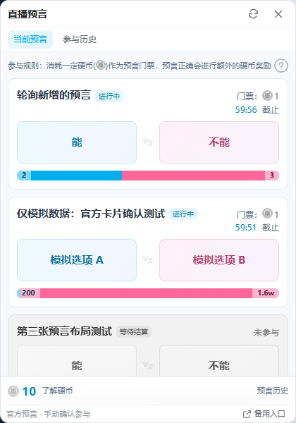
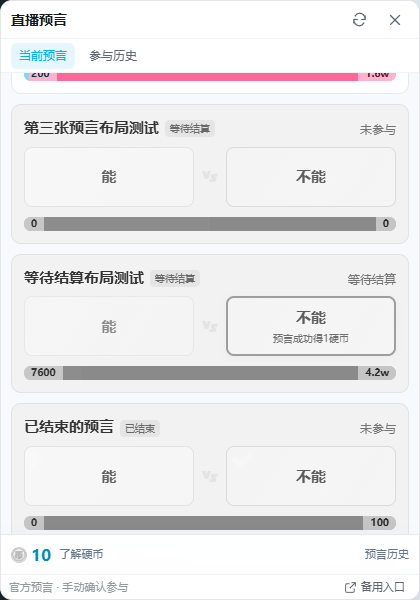

# 直播预言 1.1.6：排序、进度条与结束状态

将本地 `bilibili-live-prophecy.user.js` 完整替换到 Tampermonkey，保存并刷新整个直播间。入口版本应显示 `v1.1.6`。本次仅更新本地文件，远程安装链接仍指向上游版本。

## 改动

- 当前预言按 `publish_time` 倒序，同一时间按 `prophet_id` 倒序。若列表中存在缺失/无效时间，则整组按编号倒序，避免没有时间的新预言被排到旧预言后面。排序发生在 Vue 渲染层，不改写接口响应或官方 store，也不把“进行中”强行放到更晚发布的预言前面。
- 保留进行中卡片的蓝/粉色。等待结算、已结束、主播取消及未开始的卡片置灰，标题增加对应状态标签。沿用官方 `prophet_status`：0 未开始、1 进行中、2 等待结算、3 已结束、4 主播取消。状态 1 的官方倒计时归零后显示“等待结算”，不会误显示为已结算。
- 进度条背景独立按实际数量比例绘制，左右数字仍由官方格式化。去掉原生三角形额外占宽和数字最小宽度对比例的挤占；0/0 显示各半，单边为 0 时显示 0%/100%。条高统一为 14px，避免系统字体数字被裁切。
- 复用官方 Vue 卡片和事件，保留选项、结果图标、参与记录及确认流程。支持初始加载、父页面兼容注入，以及官方组件已挂载后的晚注入；同时处理 Composition API 对实例渲染函数的额外包装。

继续保留 1.1.5 的小数尺寸修复、原生悬停、拖动、两张卡片的紧凑布局、刷新和手动参与确认。

## 验证

2026-11-08 本机执行：

- 92 项预言 Node 回归全部通过，新增 10 项覆盖时间排序、缺失时间和大编号、更新后排序、全部状态和倒计时、极端票数、晚注入、Composition API 包装及标签去重。
- 96 项离线 Chromium 检查通过，覆盖 iframe 子页注入及父页面兼容两条路径。
- 6 个真实原生 SettingDialog 场景通过：100%/125%/150% 缩放、祖先变换、110%/133% 小数尺寸，含悬停、关闭、全屏、iframe 保留和稳定性检查。受控宿主仍记录第三方后台网络错误，预言交互断言均通过。
- 真实线上官方 H5 和 JS/CSS，配合受拦截的模拟业务数据，验证乱序响应重新排列、等待/结束/取消/未开始状态、数据刷新后的新卡插入和进行中转等待；原有卡片 DOM 均复用，store 保留官方原有顺序。
- 在 420/360/320/280px 的 iframe 宽度下验证进度条，包含 200:16000、150:3090、1:99999999、0:0 和单边零票。比例与输入相符，数字上下及左右均在条内，三角形隐藏，没有宽度挤占。选项等高 60px，奖励文字不换行。
- 标准 420×600 面板可完整显示两张进行中卡片。125% 缩放连续采样 3 秒，面板、iframe、外层页脚、余额栏及视口尺寸变化均为 0，外层 DOM 重写次数为 0。
- 取消确认、余额不足、模拟失败反馈、当前/历史/规则导航继续通过。额外验证完整挂载后再注入脚本、返回历史后重新挂载卡片，状态和排序仍生效。
- 全仓测试 186/187。唯一失败仍是既有 `BiliForge live quality applies the latest visibility request during menu loading`，断言位于 `tests/regression.test.cjs:882`；本次未改动其模块。脚本语法及补丁空白检查通过。

```powershell
npm run test:prophecy
npm run test:prophecy:browser
```

测试使用独立 Chrome 上下文，无用户登录 Cookie。业务请求被模拟或拦截，未发送真实硬币参与请求；真实账号、Tampermonkey 扩展和服务器结算仍需实际使用核对。官方组件将来调整模块结构时，展示适配可能需要更新。

## 截图

以下为真实官方组件加模拟数据，余额和预言均为测试值。





历史改动见 [1.1.5 说明](live-prophecy-1.1.5-local.md)，许可证与复用范围见 [1.1.0 说明](live-prophecy-1.1.0-local.md)。
